<p align="center"></p>

# claude-graph-skills

**Three Claude Code skills for running multi-step agent work without wasting tokens or shipping what nobody approved.**

| Skill | The one question it answers | Lasts |
|---|---|---|
| [`/graph`](skills/graph/SKILL.md) | Should this job be split across agents, how wide, and at what cost? | one run |
| [`/bakeoff`](skills/bakeoff/SKILL.md) | Which way of building should be my default for large builds? | three runs, then it retires |
| [`/dag`](skills/dag/SKILL.md) | How does a multi-step job keep its state, rerun only what changed, and release an outside effect only with a person's approval? | as long as the job exists |

📖 **Read the explainer first:** [Graph, Bakeoff, DAG, explained like you're five](https://wilsonwu-ai.github.io/claude-graph-skills/) (diagrams, motion, pros and cons, sources).

## Install

```bash
git clone https://github.com/wilsonwu-ai/claude-graph-skills && cd claude-graph-skills && ./install.sh
```

That installs all three into `~/.claude/skills/`. Start a new Claude Code session and they are live.

- **Just one or two:** `./install.sh graph` or `./install.sh bakeoff dag`.
- **Somewhere else:** set `CLAUDE_HOME` (default `~/.claude`).
- **Upgrading:** an existing folder with the same name is moved to `~/.claude/backups/`, never deleted.
- **Remove:** `./install.sh --uninstall graph`. With no name it removes all three; add `--with-gate` to remove the guard too. Uninstall deletes without a backup.
- **Optional guard:** `./install.sh --with-gate` also copies the dag-gate plugin to `~/.claude/local-mods/dag-gate`. To load it, add that path to `CLAUDE_CODE_PLUGIN_DIRS` in the `env` block of `~/.claude/settings.json` and restart. See [below](#optional-the-dag-gate-guard).

**Needs:** Claude Code, plus Python 3.9+ on macOS or Linux. The runtime uses the standard library only, with no `pip install`.

## Use them

```text
/graph task 0 = <link or context>  task 1 = <constraint>  task 2 = <the deliverable>
```
This prints a plan and stops:
- the fake edge test
- a gate that often says "one session is enough"
- a spec with an anchored verifier
- the bill

Type `go` to run it.

```text
/bakeoff task 0 = <spec>  task 1 = <the build>
```
One frozen plan, two builders, one blind judge. `/bakeoff log` shows the scorecard. `/bakeoff verdict` recommends a default after three runs per arm.

```text
"Make this a dag job: build, test, then deploy after I approve."
```
`/dag` writes a `dag.json` and runs every ready step. At the gate it stops with exit 2 and one `NEXT` line:

```text
$ python3 dag.py --spec promo/dag.json run
? review awaiting approval: /dag-approve review f94adb
  review  gate  awaiting-approval  no approval yet
  deploy  cmd!  waiting            on review (awaiting-approval)
NEXT  ask the person to review deploy.sh, out/index.json, then type: /dag-approve review f94adb
```

## What each one does better, and what it costs

### `/graph`: plans before it spawns, and is allowed to say no
Fanning out is not free. In a 260-configuration study, every multi-agent architecture scored below a single agent on SWE-bench Verified, from 2.1% (Hybrid) to 14.9% (Independent) lower ([arXiv 2512.08296](https://arxiv.org/html/2512.08296v3)). The same paper finds big gains on decomposable tasks, so the lesson is "fan-out must earn its place", not "never fan out". `/graph` makes it earn its place:
- **Fake edge test.** For every "then", it asks whether the next step actually reads the previous one's output. If not, the steps can run together.
- **Reverse test.** Two steps marked independent that write to the same file, branch or inbox have a hidden edge. That must be resolved before any fan-out.
- **A priced bill before any spawn.** It gives the realistic speedup from Amdahl's law, `S = 1/((1-p) + p/N)`, rather than the agent count. At p = 0.5 the ceiling is 2x however many agents you add, and the skill says plainly that the graph is mostly overhead.
- **Budgets on every axis:**
  - a model tier per node (haiku, sonnet or opus, depending on what the node must get right)
  - a total agent budget on every axis
  - a layered fan-in once more than about 50 records reach one synthesis step
- **Verification that reads an anchor:** a test that ran, or a file that rendered. A verifier never sees the worker's reasoning. With no anchor, the result ships labelled unverified.

**Costs and limits:**
- Its caps, budgets and "ask before publishing" rule are prompt text, not hooks. Workers get read-only or write-scoped agent types, and the main session asks in chat before any irreversible step. Nothing enforces that in code yet.
- Its token estimates are optimistic: in 33 of the author's logged fleet runs, the median run used 1.6x its estimate.
- It often answers "don't fan this out", which can feel like a wasted step.

### `/bakeoff`: a fair fight between build methods
Named for what it is: a **blind, paired champion/challenger test of build methods on frozen plans**. The mechanics come from the shared-task "bake-off" of language-technology research ([SIGHAN 2003](https://aclanthology.org/W03-1719.pdf)), which Donoho calls the [Common Task Framework](https://courses.csail.mit.edu/18.337/2015/docs/50YearsDataScience.pdf). It is not an A/B test, which randomizes live users.
- **One plan and one acceptance file, frozen,** so both arms build the same thing.
- **The challenger can be anything:** another orchestrator, another harness, or one steerable session as a control arm.
- **A blind judge.** Both diffs are relabelled X and Y in a recorded random order, then judged twice with the labels swapped to cancel position bias ([Zheng et al.](https://arxiv.org/abs/2306.05685)). The author's first run used one pass; the swap was added afterwards.

**Costs and limits:**
- It is budgeted at roughly 2x one build, because everything is built twice.
- One of two equal arms sweeps three runs a quarter of the time, so three runs show a direction, not a winner. After three runs the arm ahead is written into `/graph` and the bakeoff retires.
- A shared plan makes both arms fail together: one study saw 429 coincident failures where independence predicts 115 ([arXiv 2606.20158](https://arxiv.org/abs/2606.20158)).
- The evidence so far is one run, and it was below the size bar. Both arms failed the live eval, for the same reason: the plan asked for 32,000 output tokens on a call that must stream. Treat it as one data point.

### `/dag`: custody of anything that leaves the machine
Five read-only GitHub API censuses (900 to 3,074 repositories each) found no project, among the repositories sampled, that combines three things: a local runner on the Python standard library, human approval bound to content, and receipts. `/dag` takes the proven parts from build tools and code review:
- **Content fingerprints, including the command itself** ([DVC](https://github.com/treeverse/dvc)).
- **Early cutoff** ([Shake](https://github.com/ndmitchell/shake), [Salsa](https://github.com/salsa-rs/salsa)): a rerun that writes identical bytes leaves its dependents alone.
- **Two steps writing one target is a plan-time error** ([Ninja](https://github.com/ninja-build/ninja)). This is the reverse fake edge test, written as code.
- **Approvals bound to a digest of what was reviewed, spent once** ([Gerrit](https://github.com/GerritCodeReview/gerrit), [gittuf](https://github.com/gittuf/gittuf)). Edit a reviewed file and the approval goes stale. An outside effect runs once per approval.
- **A crash leaves "unknown", never "run the effect again".** Hash-chained receipts state what they did not observe.
- **Left out on purpose:**
  - pickled checkpoints
  - a pause that reruns the node it paused
  - sticky approvals
  - cycles
  - a database or daemon

  State is plain files in `.dag/`.
- **Tests:** 57 for the runner and 50 for the dag-gate guard, all in this repo.

**Costs and limits:**
- It adds ceremony that one-off work, notification-only jobs, or anything cheap to rerun does not need.
- A receipt checks files on disk, not what the outside system received.
- It is POSIX only (it uses `fcntl`).

## How they fit together

<p align="center"></p>

A job goes through three stages:
1. **Plan** with `/graph`.
2. **Build** in one session, a `/graph` fan-out, or a `/bakeoff`.
3. **Release** through `/dag`.

Keep **one state file per job**: `/graph`'s `run-state.json` inside a session, then a `dag.json` once the job crosses sessions or ends in an outside effect. Never track the same tasks in both.

## Optional: the dag-gate guard
[`mods/dag-gate`](mods/dag-gate/README.md) is the person's side of `/dag`. It adds six commands:
- `/dag-approve`
- `/dag-pending`
- `/dag-revoke`
- `/dag-stop`
- `/dag-resume`
- `/dag-gate-unlock`, which lets the person open the frozen files for 1 to 240 minutes.

It also refuses the model's attempts to approve or resume for you, or to write into `.dag` folders, from the main loop and from every subagent.

Limits:
- It reads command text, so it stops mistakes, but it is not an OS sandbox. Obfuscated code can evade it.
- It only holds in sessions that load it.
- It needs a Claude Code build that loads plugin hooks modules through `CLAUDE_CODE_PLUGIN_DIRS`. On builds that don't, it does not load.
- Its frozen-path rules assume `CLAUDE_HOME` is `~/.claude`.

Without the guard, approve in your own terminal with `python3 ~/.claude/skills/dag/scripts/dag.py --spec <job>/dag.json approve <gate>`.

## Layout
```
skills/graph/      SKILL.md, scripts/speedup.py, references/{budget,retro}.md
skills/bakeoff/    SKILL.md, references/{plan-shape,scorecard}.md
skills/dag/        SKILL.md, scripts/dag.py, references/spec.md, tests/
mods/dag-gate/     optional Claude Code plugin (hooks module + tests)
docs/              the explainer site (GitHub Pages)
```

Run the tests: `python3 -m unittest discover -s skills/dag/tests -v` and `claude plugin test mods/dag-gate`. The gate's TypeScript types are generated locally by Claude Code, so they are not committed.

## License
MIT
